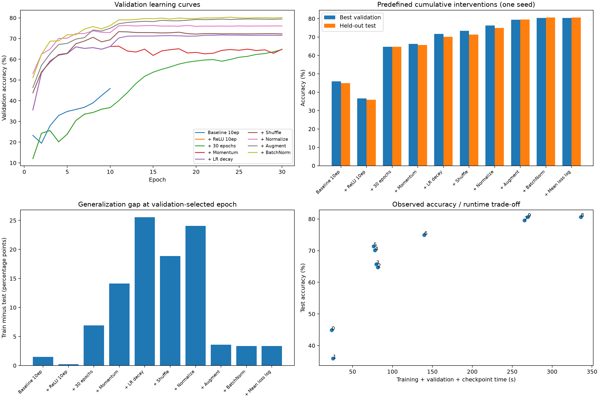
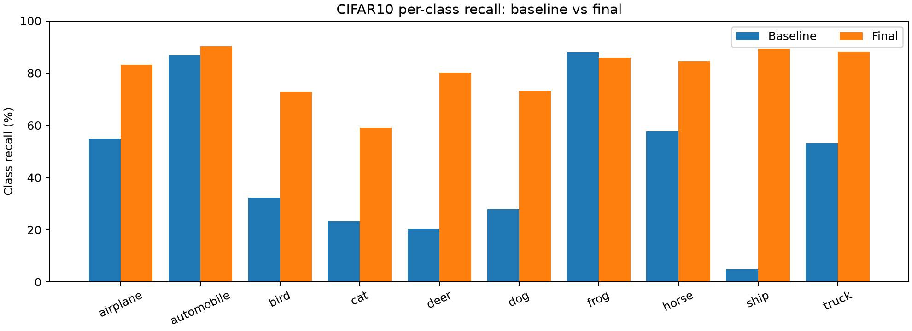

# CNN逐步改进实验日志

固定种子42，分层训练/验证=45000/5000；测试集10000张在全部方案完成后统一评估。每步从头训练，采用验证准确率最高的轮次。单种子探索性实验。

输出目录：`E:\DeepLearning\Transformer_ViT\code\CIFAR_train_CNN\experiments\20261016_150749`

## 00_baseline

训练轮数：10；最佳验证轮次：10；验证准确率：45.90%；验证平均loss：1.6934；训练耗时：23.8s；参数量：145578。

## 01_relu

训练轮数：10；最佳验证轮次：10；验证准确率：36.66%；验证平均loss：1.8697；训练耗时：25.5s；参数量：145578。

## 02_epochs30

训练轮数：30；最佳验证轮次：30；验证准确率：64.72%；验证平均loss：1.0643；训练耗时：81.5s；参数量：145578。

## 03_momentum

训练轮数：30；最佳验证轮次：11；验证准确率：66.32%；验证平均loss：1.2133；训练耗时：79.6s；参数量：145578。

## 04_scheduler

训练轮数：30；最佳验证轮次：23；验证准确率：71.74%；验证平均loss：1.2622；训练耗时：78.1s；参数量：145578。

## 05_shuffle

训练轮数：30；最佳验证轮次：11；验证准确率：73.34%；验证平均loss：0.9139；训练耗时：76.5s；参数量：145578。

## 06_normalize

训练轮数：30；最佳验证轮次：19；验证准确率：76.34%；验证平均loss：1.1630；训练耗时：139.9s；参数量：145578。

## 07_augment

训练轮数：30；最佳验证轮次：26；验证准确率：79.46%；验证平均loss：0.5949；训练耗时：265.3s；参数量：145578。

## 08_batchnorm

训练轮数：30；最佳验证轮次：24；验证准确率：80.34%；验证平均loss：0.5779；训练耗时：335.9s；参数量：145706。

## 09_loss_mean

训练轮数：30；最佳验证轮次：24；验证准确率：80.34%；验证平均loss：0.5779；训练耗时：269.6s；参数量：145706。

loss展示修正前后最终权重完全一致：`True`。

- 00_baseline：无增强训练集准确率 46.38%，官方测试准确率 44.89%，测试平均loss 1.6872。
- 01_relu：无增强训练集准确率 36.14%，官方测试准确率 35.92%，测试平均loss 1.8683。
- 02_epochs30：无增强训练集准确率 71.64%，官方测试准确率 64.72%，测试平均loss 1.0550。
- 03_momentum：无增强训练集准确率 79.82%，官方测试准确率 65.71%，测试平均loss 1.2258。
- 04_scheduler：无增强训练集准确率 95.63%，官方测试准确率 70.10%，测试平均loss 1.3093。
- 05_shuffle：无增强训练集准确率 90.21%，官方测试准确率 71.35%，测试平均loss 0.9583。
- 06_normalize：无增强训练集准确率 99.02%，官方测试准确率 74.97%，测试平均loss 1.2006。
- 07_augment：无增强训练集准确率 83.15%，官方测试准确率 79.57%，测试平均loss 0.6122。
- 08_batchnorm：无增强训练集准确率 83.98%，官方测试准确率 80.63%，测试平均loss 0.5769。
- 09_loss_mean：无增强训练集准确率 83.98%，官方测试准确率 80.63%，测试平均loss 0.5769。

# 实测汇总与分析

所有差值均为百分点，评估使用每个阶段验证准确率最高的检查点。

|阶段|改动|轮数|最佳轮|验证准确率|测试准确率|无增强训练准确率|测试较上步变化|耗时(s)|参数量|
|---|---|---:|---:|---:|---:|---:|---:|---:|---:|
|00_baseline|原始网络，10轮|10|10|45.90%|44.89%|46.38%|—|23.8|145578|
|01_relu|卷积和隐藏Linear后加ReLU|10|10|36.66%|35.92%|36.14%|-8.97|25.5|145578|
|02_epochs30|训练10→30轮|30|30|64.72%|64.72%|71.64%|+28.80|81.5|145578|
|03_momentum|SGD动量0→0.9|30|11|66.32%|65.71%|79.82%|+0.99|79.6|145578|
|04_scheduler|StepLR每10轮乘0.1|30|23|71.74%|70.10%|95.63%|+4.39|78.1|145578|
|05_shuffle|训练shuffle=False→True|30|11|73.34%|71.35%|90.21%|+1.25|76.5|145578|
|06_normalize|输入标准化至约[-1,1]|30|19|76.34%|74.97%|99.02%|+3.62|139.9|145578|
|07_augment|随机裁剪+水平翻转|30|26|79.46%|79.57%|83.15%|+4.60|265.3|145578|
|08_batchnorm|BatchNorm并移除卷积bias|30|24|80.34%|80.63%|83.98%|+1.06|335.9|145706|
|09_loss_mean|仅将显示loss改为样本平均|30|24|80.34%|80.63%|83.98%|+0.00|269.6|145706|

## 收敛速度观察

阈值仅用于描述已记录的曲线，不用于改变配置或选择检查点。

|阶段|首次验证准确率达到70%的轮数|截至该轮的累计耗时(s)|
|---|---:|---:|
|00_baseline|本预算内未达到|—|
|01_relu|本预算内未达到|—|
|02_epochs30|本预算内未达到|—|
|03_momentum|本预算内未达到|—|
|04_scheduler|11|29.3|
|05_shuffle|8|20.3|
|06_normalize|4|19.0|
|07_augment|7|63.8|
|08_batchnorm|5|45.9|
|09_loss_mean|5|45.4|

## 可以由本次实验支持的观察

1. **激活函数与训练预算存在条件依赖。** ReLU的10轮验证准确率由45.90%变为36.66%，其30轮达到64.72%。因此本次不能声称加ReLU就会立刻提高准确率；前10轮逐轮复现已核对。由于没有无ReLU的30轮对照，不能声称ReLU在30轮优于原网络。

2. **动量的边际效果：** 在前序配置基础上，最佳验证准确率变化+1.60个百分点，测试准确率变化+0.99个百分点。该效果依赖此前累计设置，不能解释为对所有CNN的独立平均效果。

3. **学习率衰减的边际效果：** 在前序配置基础上，最佳验证准确率变化+5.42个百分点，测试准确率变化+4.39个百分点。该效果依赖此前累计设置，不能解释为对所有CNN的独立平均效果。

4. **打乱顺序的边际效果：** 在前序配置基础上，最佳验证准确率变化+1.60个百分点，测试准确率变化+1.25个百分点。该效果依赖此前累计设置，不能解释为对所有CNN的独立平均效果。

5. **标准化的边际效果：** 在前序配置基础上，最佳验证准确率变化+3.00个百分点，测试准确率变化+3.62个百分点。该效果依赖此前累计设置，不能解释为对所有CNN的独立平均效果。

6. **数据增强的边际效果：** 在前序配置基础上，最佳验证准确率变化+3.12个百分点，测试准确率变化+4.60个百分点。该效果依赖此前累计设置，不能解释为对所有CNN的独立平均效果。

7. **BatchNorm配置的边际效果：** 在前序配置基础上，最佳验证准确率变化+0.88个百分点，测试准确率变化+1.06个百分点。该效果依赖此前累计设置，不能解释为对所有CNN的独立平均效果。

8. **增强的泛化表现：** 增强前后训练—测试差距由24.05变为3.58个百分点；这里的训练集准确率均使用无增强数据、eval模式和验证选定的检查点，避免把增强后的在线训练准确率与干净测试准确率直接比较。

9. **日志修正不是模型改进。** 最后两阶段只改变loss的显示口径，CSV都保存样本平均loss与batch均值之和。最终权重逐元素相同的检查结果记录在上方；这证明该统计修正不改变参数更新。

10. **最终累计变化：** 测试准确率从44.89%到80.63%，变化+35.74个百分点；参数量从145578到145706。大部分步骤未增加参数，观察到的变化不能简单归因为网络变大。

按验证集而非测试集选择的最高验证方案为`08_batchnorm`，验证准确率80.34%，对应测试准确率80.63%；最后累计方案不必然是最佳方案。

## CNN结构层面的解释

该模型通过卷积的局部连接与权重共享提取空间特征，三次池化将32×32降至4×4，再由分类头读取。卷积参数不随输入像素位置重复增加；ReLU不增加可学习参数。原模型仍有MaxPool非线性，不能称为纯线性网络，但两个连续Linear可合并为一个仿射变换。加入ReLU增加了特征变换能力，能否发挥作用受训练设置影响。

本实验没有对卷积、权重共享或池化进行单独消融，所以上述是结构解释，而不是本实验对这些机制优越性的直接证明。也没有运行ViT，不能据此得出CNN优于ViT。

## 边界、混杂因素与后续验证

- 单个随机种子42，无法估计训练随机性的方差，也不能宣称统计显著。建议以同样划分复跑种子0、1、2等，报告均值与标准差。

- 这是预先固定的累加对照，不是完整因子实验；后一步的效应依赖前一步设置。数据增强同时包含裁剪和翻转，不能分离二者贡献。

- BatchNorm阶段同时移除了卷积bias，参数量略变；应称为BatchNorm配置的组合效果。若要严格分离BN作用，需要保留bias的额外对照。

- 所有方案训练完后才查看官方测试集，各阶段检查点只用验证集选择。后续若根据这些测试结果修改方案，需要新的独立验证流程，不能反复利用测试集调参。

- 当前45,000训练样本、固定种子、确定性设置与上一次50,000训练样本的随机基线不同，不能将旧的56.25%当成本轮严格配对的基线。

- 运行耗时使用CPU张量缓存、固定线程数4及确定性CUDA，包含训练、验证和保存，不含最终统一评估。数据增强增加CPU工作，耗时不能只解释为网络推理成本；缓存等价性抽样检查见cache_equivalence.json。

- 耗时来自单次顺序运行，仍受缓存预热、温控和系统负载影响，不属于重复测量的硬件基准。

- 正式架构对照建议补充无ReLU的30轮实验、多个种子、不同学习率，以及保留卷积bias的BN对照。

## 对后续CNN与ViT比较的启示

本次同一小型CNN在不同训练配置下的结果可能差别很大，因此不应拿一个尚未充分优化的CNN与另一套训练配置下的ViT比较后，将全部差异归因于架构。后续应固定训练/验证/测试划分、统一数据处理和指标口径，并明确训练预算、优化器与调参预算；允许各架构使用适合自身的优化器时，也应清楚记录差异。本次没有ViT实测数据。

## 各类识别表现

|类别|基线召回率|最终召回率|变化(百分点)|
|---|---:|---:|---:|
|airplane|54.80%|83.10%|+28.30|
|automobile|86.80%|90.30%|+3.50|
|bird|32.30%|72.80%|+40.50|
|cat|23.20%|59.00%|+35.80|
|deer|20.30%|80.20%|+59.90|
|dog|27.90%|73.10%|+45.20|
|frog|88.00%|85.80%|-2.20|
|horse|57.70%|84.60%|+26.90|
|ship|4.80%|89.30%|+84.50|
|truck|53.10%|88.10%|+35.00|

**类别层面的发现：** 最低类别召回率从ship的4.80%提升到cat的59.00%。整体准确率提升并不保证每一类都改善；本次下降的类别为frog（-2.20个百分点）。各类训练与测试样本数相同，因此不能只用类别样本数量不平衡解释基线的类别表现差异；具体混淆原因仍需要查看误分类图像。

基线测试准确率的Wilson 95%区间（仅条件于这一次训练和测试样本抽样，不含训练种子方差）：[43.92%, 45.87%]。

最终测试准确率的Wilson 95%区间（仅条件于这一次训练和测试样本抽样，不含训练种子方差）：[79.84%, 81.39%]。

## 每步代码与动机

以下为实际使用的关键改动，完整版本保存在各阶段目录中。所有阶段均从相同seed重新初始化，而不是在上一阶段权重上继续训练。

1. ReLU：在每个Conv2d与MaxPool2d之间、两个Linear之间插入`nn.ReLU()`，增加非线性表达能力，不增加参数。

2. 训练预算：`epoch = 10`改为`epoch = 30`，观察更充分优化的作用。

3. 动量：`torch.optim.SGD(..., lr=0.01, momentum=0.9)`，综合历史更新方向；不是更换为另一类网络。

4. 学习率：`StepLR(optimizer, step_size=10, gamma=0.1)`，每轮末尾执行`scheduler.step()`；第1—10轮lr=0.01，第11—20轮0.001，第21—30轮0.0001。

5. 打乱：训练DataLoader使用`shuffle=True`，验证与测试保持False。

6. 标准化：训练、验证、测试都在ToTensor后使用`Normalize((0.5,)*3, (0.5,)*3)`。这不是从测试集估计统计量，而是预先选定的固定映射。

7. 增强：只在训练预处理开头添加`RandomCrop(32, padding=4)`与`RandomHorizontalFlip()`，让同一图片在不同轮次呈现位置和方向变化。

8. BatchNorm：每个卷积后添加`nn.BatchNorm2d(out_channels)`再接ReLU，并将该卷积设为`bias=False`。BN增加的缩放/偏移参数与移除的bias需一并记录。

9. loss口径：先累计`loss.item() * imgs.size(0)`，再除以数据集大小；这一统计量位于反向传播以外，不参与参数更新。

## 文件与复现

- `CNN_experiment_runner.py`：按预定次序生成脚本、逐步训练、统一测试。

- `protocol.json`：预先固定的设置；`summary.csv/json`：总表；`changes.patch`：相邻版本逐行差异。

- 每步目录的`CNNtrain_gpu1.py`保存当时版本，`metrics.csv`为逐轮结果，`best.pth/last.pth`为权重，`evaluation.json`包含混淆矩阵。

- `original_CNNtrain_gpu1.py`为原始备份。当前主脚本保留最后一步设置。

- `experiment_comparison.png/pdf`：学习曲线、阶段准确率、泛化差距和耗时；`class_recall.png`：类别召回率。

- 图表编号0至9对应总表阶段顺序。以下为直接嵌入的结果图。

